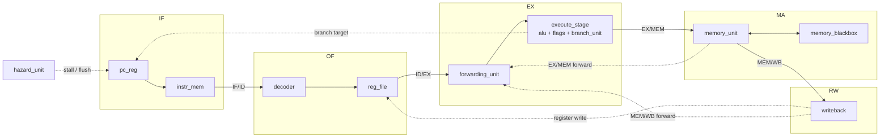

# SimpleRisc 5-Stage Pipelined CPU

A 32-bit, 5-stage pipelined processor for the **SimpleRisc** instruction set, written from scratch in plain **Verilog-2005**. It includes full hazard handling (forwarding, load-use stalls and branch flushing), and every individual module has its own self-checking unit test.

```
IF  →  OF  →  EX  →  MA  →  RW
fetch  decode  execute  memory  write-back
```

**Authors:** Khushwant Singh and Magizhnan

---

## Table of contents

1. [Why we built this](#1-why-we-built-this)
2. [Features at a glance](#2-features-at-a-glance)
3. [Work split](#3-work-split)
4. [Repository layout](#4-repository-layout)
5. [The SimpleRisc ISA](#5-the-simplerisc-isa)
6. [Microarchitecture](#6-microarchitecture)
7. [The control bundle](#7-the-control-bundle)
8. [Hazards and how they are handled](#8-hazards-and-how-they-are-handled)
9. [Module reference](#9-module-reference)
10. [Verification](#10-verification)
11. [Running the tests](#11-running-the-tests)
12. [Design decisions](#12-design-decisions)
13. [Limitations and future work](#13-limitations-and-future-work)
14. [References](#14-references)

---

## 1. Why we built this

We built this processor as our **Minor Project**. A pipelined CPU is the point where computer architecture stops being diagrams in a textbook and becomes real timing problems. In a single-cycle CPU every instruction finishes before the next one starts, so instructions never interfere with each other. In a pipeline, up to five instructions are in flight at once. That immediately raises three questions:

- What happens when an instruction needs a result that the previous instruction has not written back yet? (**data hazards**)
- What happens to the instructions already fetched behind a branch that turns out to be taken? (**control hazards**)
- What happens when two stages need the same hardware in the same cycle? (**structural hazards**)

Our goals were to:

- **Implement a real ISA end to end.** We chose SimpleRisc, from Smruti R. Sarangi's *Computer Organisation and Architecture*, because it is small enough to finish but complete: arithmetic, logic, shifts, loads and stores, conditional branches, and function calls with `call` and `ret`.
- **Solve every pipeline hazard in hardware.** The CPU runs unmodified programs correctly, with no `nop`s inserted by hand and no help from a compiler.
- **Lose as few cycles as possible.** Forwarding removes almost all data stalls. The only remaining penalties are 1 cycle for a load-use and 2 cycles for a taken branch.
- **Verify everything.** Every module has its own self-checking testbench that prints the inputs, expected value and actual value of every single check.
- **Write portable RTL.** Everything is plain Verilog-2005 with no SystemVerilog, so it builds with free tools like Icarus Verilog.

---

## 2. Features at a glance

| | |
|---|---|
| **ISA** | SimpleRisc: 21 instructions, 32-bit fixed-width encoding |
| **Data width** | 32-bit, two's complement |
| **Registers** | 16 × 32-bit (`r0`–`r15`), with `r14` = stack pointer and `r15` = return address |
| **Pipeline** | 5 stages: IF → OF → EX → MA → RW |
| **Data hazards** | Full forwarding from EX/MEM and MEM/WB into EX, plus a write-first register-file bypass |
| **Load-use** | Detected automatically: 1-cycle stall + bubble |
| **Branches** | Resolved in EX, 2 wrong-path instructions flushed (2-cycle penalty) |
| **Memory** | Separate instruction and data memories (Harvard style), 4 KB each by default |
| **Language** | Verilog-2005, simulated with Icarus Verilog |
| **Unit tests** | 14 self-checking unit testbenches, **3,460 checks**, all passing |
| **Co-simulation** | RTL compared against independent C++ reference models using constrained-random stimulus: 8 modules × 50,000 vectors, plus 2,011 programs (~674,000 instructions) on the full CPU |

---

## 3. Work split

| Part | Owner | Modules |
|---|---|---|
| **Fetch + decode** (IF, OF) | Magizhnan | `pc_reg`, `instr_mem`, `if_id_reg`, `decoder`, `reg_file`, `id_ex_reg` |
| **Execute, memory, write-back** (EX, MA, RW) | Khushwant | `alu`, `flags`, `branch_unit`, `execute_stage`, `ex_mem_reg`, `memory_unit`, `mem_wb_reg`, `writeback` |
| **Shared** (pipeline-wide logic) | Both | `defines.vh`, `forwarding_unit`, `hazard_unit`, `memory_blackbox`, `top_module` |

Each person also wrote the unit tests for their own modules.

---

## 4. Repository layout

```
khushwant/            EX, MA and RW stage modules
  alu.v               combinational ALU (14 operations)
  flags.v             E / GT flags register, written by cmp
  branch_unit.v       decides whether to branch, and where to
  execute_stage.v     EX stage: operand mux + ALU + flags + branch unit
  ex_mem_reg.v        EX/MEM pipeline register
  memory_unit.v       MA stage: drives the data memory port
  mem_wb_reg.v        MEM/WB pipeline register
  writeback.v         RW stage: picks the value written to the register file

magizhnan/            IF and OF stage modules
  pc_reg.v            program counter
  instr_mem.v         instruction memory
  if_id_reg.v         IF/ID pipeline register
  decoder.v           instruction decoder, produces the control bundle
  reg_file.v          16 × 32-bit register file
  id_ex_reg.v         ID/EX pipeline register

shared/               pipeline-wide modules
  defines.vh          opcodes, ALU ops, control-bit positions, constants
  forwarding_unit.v   resolves data hazards by bypassing results
  hazard_unit.v       load-use stall and branch flush control
  memory_blackbox.v   data memory
  top_module.v        top level: wires all stages together

tests/
  khushwant/          unit tests for Khushwant's modules (8 testbenches)
  magizhnan/          unit tests for Magizhnan's modules (6 testbenches)

cosim/                co-simulation against C++ reference models
  model/              C++ models, one header per RTL module (decoder.h, alu.h, ...)
                      simplerisc.h   instruction-set simulator of the whole CPU
                      programs.h     constrained-random and directed program generator
                      vectors.h      constrained-random input vectors for each module
                      compare.h      compares the C++ and RTL traces
  tb/                 Verilog testbenches that replay the same vectors and programs on the RTL
  run.sh              builds everything, runs both sides, compares, prints coverage
```

---

## 5. The SimpleRisc ISA

### 5.1 Registers

- 16 general-purpose 32-bit registers, `r0` to `r15`.
- `r14` is used as the **stack pointer** (`sp`) and `r15` as the **return address** (`ra`).
- Unlike MIPS or RISC-V, **`r0` is a normal register**. It is not hardwired to zero.
- Two condition flags, **E** (equal) and **GT** (greater than), are set by `cmp` and read by `beq` and `bgt`.

### 5.2 Instruction formats

Every instruction is 32 bits. The top 5 bits are always the opcode.

```
Register form (I = 0):
 31      27  26  25    22  21    18  17    14  13              0
┌──────────┬───┬────────┬────────┬────────┬──────────────────┐
│  opcode  │ 0 │   rd   │  rs1   │  rs2   │      unused      │
└──────────┴───┴────────┴────────┴────────┴──────────────────┘

Immediate form (I = 1):
 31      27  26  25    22  21    18  17 16  15               0
┌──────────┬───┬────────┬────────┬──────┬───────────────────┐
│  opcode  │ 1 │   rd   │  rs1   │ mod  │      imm[15:0]    │
└──────────┴───┴────────┴────────┴──────┴───────────────────┘

Branch form:
 31      27  26                                              0
┌──────────┬─────────────────────────────────────────────────┐
│  opcode  │                  offset[26:0]                   │
└──────────┴─────────────────────────────────────────────────┘
```

- **I bit (bit 26):** selects whether the second operand is the register `rs2` or the immediate.
- **Modifier bits `mod` (bits 17:16), used when I = 1:**

| `mod` | Suffix | Meaning | Example: `imm = 0xFFFD` |
|---|---|---|---|
| `00` | (none) | sign-extend | `0xFFFFFFFD` (= -3) |
| `01` | `u` | zero-extend (unsigned) | `0x0000FFFD` |
| `10` | `h` | load into the upper 16 bits | `0xFFFD0000` |

- **Branch target:** `pc + (sign_extend(offset) << 2)`. The offset counts **instructions**, not bytes. An offset of `0` branches to itself (`b .`), which test programs use to mean "halt".

### 5.3 Instruction set

| Opcode | Instruction | Operation | Notes |
|---|---|---|---|
| `00000` | `add rd, rs1, rs2/imm` | rd ← rs1 + op2 | |
| `00001` | `sub rd, rs1, rs2/imm` | rd ← rs1 − op2 | |
| `00010` | `mul rd, rs1, rs2/imm` | rd ← rs1 × op2 | low 32 bits |
| `00011` | `div rd, rs1, rs2/imm` | rd ← rs1 ÷ op2 | signed, rounds toward zero; ÷0 gives 0 |
| `00100` | `mod rd, rs1, rs2/imm` | rd ← rs1 mod op2 | signed, sign follows the dividend; mod 0 gives 0 |
| `00101` | `cmp rs1, rs2/imm` | E ← (rs1 = op2), GT ← (rs1 > op2) | signed compare, no register write |
| `00110` | `and rd, rs1, rs2/imm` | rd ← rs1 & op2 | |
| `00111` | `or rd, rs1, rs2/imm` | rd ← rs1 \| op2 | |
| `01000` | `not rd, rs2/imm` | rd ← ~op2 | uses only the second operand |
| `01001` | `mov rd, rs2/imm` | rd ← op2 | uses only the second operand |
| `01010` | `lsl rd, rs1, rs2/imm` | rd ← rs1 << op2[4:0] | logical shift left |
| `01011` | `lsr rd, rs1, rs2/imm` | rd ← rs1 >> op2[4:0] | logical shift right (fills with 0) |
| `01100` | `asr rd, rs1, rs2/imm` | rd ← rs1 >>> op2[4:0] | arithmetic shift right (fills with the sign bit) |
| `01101` | `nop` | — | encoded as `0x68000000` |
| `01110` | `ld rd, imm[rs1]` | rd ← MEM[rs1 + imm] | 32-bit word load |
| `01111` | `st rd, imm[rs1]` | MEM[rs1 + imm] ← rd | 32-bit word store; **rd is a source here** |
| `10000` | `beq offset` | if E: pc ← target | |
| `10001` | `bgt offset` | if GT: pc ← target | |
| `10010` | `b offset` | pc ← target | unconditional |
| `10011` | `call offset` | ra ← pc + 4, pc ← target | writes `r15` |
| `10100` | `ret` | pc ← ra | reads `r15` |

Any opcode not in this table decodes as a bubble (it does nothing).

---

## 6. Microarchitecture

### 6.1 Block diagram



### 6.2 What each stage does

| Stage | Modules | Work done in this stage |
|---|---|---|
| **IF** (fetch) | `pc_reg`, `instr_mem` | Read the instruction at `pc`. Next PC = `pc + 4`, or the branch target if a branch was taken in EX. |
| **OF** (operand fetch / decode) | `decoder`, `reg_file` | Split the instruction into fields, extend the immediate, build the control bundle, and read `rs1` and `rs2` from the register file. |
| **EX** (execute) | `forwarding_unit`, `execute_stage` | Replace stale operands with forwarded values, pick the register or immediate operand, run the ALU, update the flags (for `cmp`), compute the branch target and decide whether the branch is taken. |
| **MA** (memory access) | `memory_unit`, `memory_blackbox` | For `ld`, read memory at `alu_result`. For `st`, write `op2` to memory at `alu_result`. Other instructions pass through. |
| **RW** (register write) | `writeback` | Choose the value to write (ALU result, loaded data, or `pc + 4` for `call`) and write it into the register file. |

### 6.3 Pipeline registers

Between every pair of stages there is a pipeline register that holds one instruction's worth of state. A register named **X/Y** sits between stages X and Y, and holds the instruction **currently in stage Y**.

| Register | Holds | Can stall? | Can flush? |
|---|---|---|---|
| `if_id_reg` | `pc`, `instr` | yes (load-use) | yes (taken branch → loads `nop`) |
| `id_ex_reg` | `pc`, `rs1_data`, `rs2_data`, `imm_ext`, `branch_offset`, `rd/rs1/rs2_addr`, `ctrl` | not used | yes (taken branch or load-use → loads a bubble) |
| `ex_mem_reg` | `pc`, `alu_result`, `op2` (store data), `rd_addr`, `ctrl` | no | no |
| `mem_wb_reg` | `pc`, `alu_result`, `ld_result`, `rd_addr`, `ctrl` | no | no |

EX/MEM and MEM/WB never stall or flush. Once an instruction reaches EX it always completes, because branches resolve in EX and only ever flush the stages behind them.

### 6.4 Signal naming in `top_module`

Wires are prefixed with the stage they belong to: `if_`, `id_`, `ex_`, `mem_`, `wb_`. For example, `ex_ctrl` is the control bundle of the instruction in EX in the current cycle. As an instruction moves down the pipeline, its information moves `id_ctrl → ex_ctrl → mem_ctrl → wb_ctrl`.

---

## 7. The control bundle

The decoder turns each instruction into a **17-bit control vector** (`ctrl`). This vector travels down the pipeline with the instruction, and each stage reads the bits it needs. Bit positions are defined once in `shared/defines.vh`.

| Bit(s) | Name | Set for | Used by |
|---|---|---|---|
| 0 | `C_REG_WRITE` | ALU ops, `not`, `mov`, `ld`, `call` | RW (register write enable), forwarding unit |
| 1 | `C_MEM_READ` | `ld` | hazard unit (load-use), MA (read enable), forwarding unit |
| 2 | `C_MEM_WRITE` | `st` | MA (write enable) |
| 3 | `C_BRANCH` | `beq`, `bgt` | branch unit |
| 4 | `C_BRANCH_GT` | `bgt` | branch unit (1 = test GT, 0 = test E) |
| 5 | `C_JUMP` | `b`, `call` | branch unit |
| 6 | `C_IS_CALL` | `call` | RW (write `pc + 4` to `r15`), forwarding |
| 7 | `C_IS_RET` | `ret` | branch unit (jump to `r15`) |
| 8 | `C_ALU_SRC_IMM` | I = 1, `ld`, `st` | EX operand mux |
| 9 | `C_MEM_TO_REG` | `ld` | RW (write the loaded value) |
| 10 | `C_FLAGS_WRITE` | `cmp` | flags register |
| 11 | `C_RS1_VALID` | instructions that really read `rs1` | forwarding and hazard units |
| 12 | `C_RS2_VALID` | instructions that really read `rs2` | forwarding and hazard units |
| 16:13 | `C_ALU_OP` | every instruction | ALU operation select |

**`CTRL_BUBBLE`** = `{ALU_NOP, 13'b0}`: no writes, no branches, ALU does nothing. Reset and every flush load this value. Plain all-zeros is **not** used, because `ALU_OP = 0` means `ADD`.

### How the decoder handles the special cases

The decoder normalises unusual instructions, so the hazard and forwarding logic never needs opcode-specific checks. Those units only look at `rs1/rs2_addr`, the valid bits, `rd_addr` and `reg_write`.

- **`st rd, imm[rs1]`**: the `rd` field is the value being **stored**, so it is actually a source register. The decoder outputs it as `rs2` with `rs2_valid = 1` and `reg_write = 0`.
- **`ret`**: reads `r15` even though the encoding has no register field. The decoder outputs `rs1 = r15`, `rs1_valid = 1`.
- **`call`**: writes `r15` even though the encoding has no register field. The decoder outputs `rd = r15`, `reg_write = 1`, and write-back chooses `pc + 4` as the value.
- **`not` / `mov`**: only read the second operand, so `rs1_valid = 0`.
- **Immediate forms**: `rs2_valid = 0`, so immediate bits that happen to sit in the `rs2` field never cause a false hazard.

---

## 8. Hazards and how they are handled

### 8.1 Summary

| Situation | Handled by | Cost |
|---|---|---|
| Result needed by the very next instruction | forwarding: EX/MEM → EX | 0 cycles |
| Result needed 2 instructions later | forwarding: MEM/WB → EX | 0 cycles |
| Result needed 3 instructions later | register-file write-first bypass | 0 cycles |
| `ld` immediately followed by an instruction that uses the loaded register | hazard unit: stall PC and IF/ID, bubble into ID/EX | **1 cycle** |
| Taken `beq` / `bgt` / `b` / `call` / `ret` | hazard unit: flush IF/ID and ID/EX, PC ← target | **2 cycles** |
| `cmp` immediately followed by `beq` / `bgt` | flags written at the end of `cmp`'s EX cycle | 0 cycles |
| Instruction fetch and data access in the same cycle | separate instruction and data memories | 0 cycles |

### 8.2 Structural hazards

These are avoided by design:

- **Separate instruction and data memories**, so IF and MA never compete for one memory port.
- **The register file reads and writes in the same cycle.** It has two read ports for OF and one write port for RW. If RW writes a register in the same cycle OF reads it, the new value is passed straight through (write-first bypass).

### 8.3 Data hazards: forwarding

The values an instruction reads in OF can be out of date, because older instructions may still be in the pipeline with results that have not been written back yet. The **forwarding unit** checks each EX operand against the two older instructions:

```
add r1, r6, r7    ← in RW   (two instructions older)
sub r2, r8, r9    ← in MA   (one instruction older)
and r5, r1, r2    ← in EX   (needs r1 and r2 now)
```

- `r2` is being written by the instruction in MA, so `op2` is taken from **EX/MEM** (`sub`'s ALU result).
- `r1` is being written by the instruction in RW, so `op1` is taken from **MEM/WB** (`add`'s write-back value).

For each operand, the rule is:

```
if   (operand is really read && MA writes a register && MA is not a load && MA.rd == operand)  → use EX/MEM
elif (operand is really read && RW writes a register && RW.rd == operand)                     → use MEM/WB
else                                                                                           → use the register-file value
```

- **EX/MEM wins over MEM/WB** when both match, because the instruction in MA is younger and holds the newer value.
- **"Forwarding from MEM" does not mean taking data from memory.** It means taking the value stored in the EX/MEM pipeline register: the ALU result of the instruction in MA, computed one cycle earlier but not yet written to the register file.
- **For a `call` in MA**, the forwarded value is `pc + 4` instead of the ALU result.
- **A load in MA is never forwarded from EX/MEM.** For a load, EX/MEM holds the address, not the data. This case is handled by the load-use stall instead.
- **Two separate decision chains** exist, one per operand, so `op1` can come from MEM/WB while `op2` comes from EX/MEM in the same cycle.
- **Distance 3 and beyond** needs no forwarding: by then the result is in the register file, or being written in the same cycle, which the write-first bypass covers.

### 8.4 Data hazards: load-use stall

Forwarding cannot cover a load followed immediately by a use of the loaded register:

```
ld  r1, 8[r2]
add r3, r1, r4
```

When `add` reaches EX, `ld` is only in MA, and the loaded value is not yet available for forwarding. The **hazard unit** detects this case while `ld` is in EX and `add` is in OF:

```verilog
rs1_match = id_rs1_valid && (id_rs1_addr == ex_rd_addr);
rs2_match = id_rs2_valid && (id_rs2_addr == ex_rd_addr);
load_use  = ex_mem_read_en && (rs1_match || rs2_match);
```

In words: the instruction in EX is a load, **and** the instruction in OF really reads the register that load will write.

On a load-use hazard:

- **PC and IF/ID are stalled.** `add` is a correct instruction, so it waits in OF instead of being thrown away.
- **ID/EX is flushed.** ID/EX normally copies whatever is in OF, so without the flush, `add` would enter EX too early. A bubble fills EX instead.
- **`ld` keeps moving.** It goes on to MA to read its data. Only the stages behind it freeze.

| Cycle | OF | EX | MA | RW |
|---|---|---|---|---|
| 1 | add | ld | | |
| 2 | add *(stalled)* | bubble *(flushed)* | ld | |
| 3 | next | add | bubble | ld → value forwarded to add via MEM/WB |

### 8.5 Control hazards: branch flush

Branches are resolved in **EX**. By then, two more instructions have already been fetched behind the branch: one in OF and one in IF. If the branch is taken, those two are on the wrong path:

- **IF/ID is flushed** (loads a `nop`), which removes the instruction that was about to enter OF.
- **ID/EX is flushed** (loads a bubble), which removes the instruction that was about to enter EX.
- **The PC loads the branch target**, so the correct instruction is fetched next.

The cost is 2 cycles per taken branch. A branch that is not taken costs nothing, because the pipeline simply keeps going.

If a taken branch and a load-use hazard ever happened in the same cycle, **the branch wins**. The instruction in OF is about to be flushed anyway, so stalling it would be pointless. This is why both stall signals are gated with `!branch_taken`.

### 8.6 Flags timing

`cmp` writes the flags register on the clock edge at the end of its EX cycle. A `beq` or `bgt` right after it is in EX one cycle later, so it already sees the new flags. No forwarding is needed for the flags.

---

## 9. Module reference

### Khushwant: EX, MA and RW

| Module | Type | Description |
|---|---|---|
| `alu` | combinational | 14 operations selected by `alu_op`. Division, modulo and arithmetic shift right are signed. Divide and mod by zero return 0, so simulation never produces X. `not` and `mov` use only operand `b`. Shifts use only `b[4:0]`. The signed results are kept in separate signed wires, because inside a `?:` mixed with unsigned operands, Verilog would perform the operation unsigned. |
| `flags` | sequential | Holds E and GT. On a clock edge where `write_en` is 1 (a `cmp` in EX), sets `E = (a == b)` and `GT = $signed(a) > $signed(b)`. Otherwise holds its value. Asynchronous active-low reset. |
| `branch_unit` | combinational | `taken = jump \| is_ret \| (branch & (branch_gt ? GT : E))`. Target = `ret_addr` (the forwarded value of `r15`) for `ret`, otherwise `branch_target`. |
| `execute_stage` | mixed | Second-operand mux (`imm_ext` if the I bit is set, else `op2`), branch-target adder `pc + {sign_ext(offset), 2'b00}`, and one instance each of `alu`, `flags` and `branch_unit`. |
| `ex_mem_reg` | sequential | EX/MEM pipeline register. Reset sets `ctrl` to `CTRL_BUBBLE`. |
| `memory_unit` | combinational | Address = `alu_result`, write data = `op2`, `we = C_MEM_WRITE`, `re = C_MEM_READ`. `ld_result` carries the memory data only for loads, and is 0 otherwise. |
| `mem_wb_reg` | sequential | MEM/WB pipeline register. Holds both the ALU result and the load result, so write-back can choose between them. |
| `writeback` | combinational | `call` → write `pc + 4` to `r15`. `ld` → write `ld_result`. Otherwise → write `alu_result`. Write enable = `C_REG_WRITE`. |

### Magizhnan: IF and OF

| Module | Type | Description |
|---|---|---|
| `pc_reg` | sequential | Program counter. Resets to 0, loads `pc_next` every cycle unless stalled. |
| `instr_mem` | combinational read | Word-addressed instruction memory (`addr[31:2]`). The program is preloaded by the testbench. Prints a warning if the PC goes out of range. |
| `if_id_reg` | sequential | Reset and flush load `NOP_INSTR` (`0x68000000`), not all-zeros, because `0x00000000` decodes as `add r0, r0, r0`. Stall holds the contents. Flush has priority over stall. |
| `decoder` | combinational | Extracts the fields, extends the immediate according to the modifier, and builds the control bundle, including the `st` / `ret` / `call` normalisation described in [section 7](#how-the-decoder-handles-the-special-cases). |
| `reg_file` | sequential write, combinational read | 16 × 32-bit registers, all reset to 0. Two read ports, one write port, with a write-first bypass when reading the register being written in the same cycle. `r0` is a normal register. |
| `id_ex_reg` | sequential | Carries everything EX and later stages need, including the source register **addresses**, which the forwarding unit compares. Reset and flush load `CTRL_BUBBLE`. Flush has priority over stall. |

### Shared

| Module | Type | Description |
|---|---|---|
| `defines.vh` | header | Opcodes, ALU operation codes, control-bit positions, `CTRL_BUBBLE`, `NOP_INSTR`, `REG_SP` / `REG_RA`, and forwarding-select codes. |
| `forwarding_unit` | combinational | Chooses the source of `op1` and `op2` (register file, EX/MEM or MEM/WB). See [8.3](#83-data-hazards-forwarding). |
| `hazard_unit` | combinational | Detects load-use and produces `pc_stall`, `if_id_stall`, `if_id_flush` and `id_ex_flush`. See [8.4](#84-data-hazards-load-use-stall) and [8.5](#85-control-hazards-branch-flush). |
| `memory_blackbox` | sequential write, combinational read | Data memory: 1024 words × 4 bytes = **4 KB** by default (the `DEPTH` parameter). Word-addressed with `addr[31:2]`: the CPU uses byte addresses, every word is 4 bytes, and dropping the low 2 bits divides by 4. Writes happen on the rising clock edge. Reads are combinational, so a load completes within its MA cycle. Out-of-range reads return 0, and out-of-range writes are dropped with a warning. |
| `top_module` | structural | Instantiates and connects every module. Only inputs are `clk` and `rst_n`. Debug outputs: `dbg_pc`, `dbg_wb_en`, `dbg_wb_addr`, `dbg_wb_data`, `dbg_stall`, `dbg_flush`. |

---

## 10. Verification

### 10.1 Approach

Every module has its own **self-checking testbench**. No waveform inspection is needed to know whether a module works. Each testbench:

1. Instantiates one module (the DUT, "device under test").
2. Drives its inputs, waits for combinational logic to settle (`#1`) or for a clock edge (`@(posedge clk); #1`), then compares every relevant output with its expected value.
3. Compares using `===` instead of `==`, so an output that is X or Z counts as a failure instead of slipping through.
4. Prints a detailed line for **every** check, then a summary at the end.

### 10.2 Output format

Every check prints the test name, the DUT's inputs at that moment, and the expected and actual values. Failed checks are marked with an arrow, and the summary lists the numbers of all failed checks, so a failure can be found immediately.

```
PASS  #5  ld rd
      inputs  : ctrl=00000001000000011 pc=00000100 alu_result=aaaaaaaa ld_result=55555555 rd_addr=3
      expected: 3   actual: 3   (time 2000)
FAIL  #6  call data = pc + 4   <-------
      inputs  : ctrl=11010000001100001 pc=00000100 alu_result=aaaaaaaa ld_result=55555555 rd_addr=0
      expected: 104   actual: 108   (time 3000)
...
11 checks, 10 passed, 1 failed
failed checks: #6
TB_RESULT: FAIL
```

(This example output was produced by deliberately planting a bug in `writeback`, to show what a failure looks like.)

`ctrl` is printed in binary so each control bit can be read directly. Bit 0 is the rightmost digit, and the meaning of each bit is in [section 7](#7-the-control-bundle).

### 10.3 Test coverage

**Khushwant's modules**

| Testbench | Checks | What is tested |
|---|---|---|
| `tb_alu` | 2,827 | Hand-picked edge cases for every operation: overflow and wrap-around, signed div/mod in all sign combinations, divide and mod by zero, logical vs arithmetic shifts, shift amounts above 31. Then 200 rounds of random inputs for each of the 14 operations, checked against an independent reference model written inside the testbench. |
| `tb_branch_unit` | 137 | **Exhaustive**: all 2⁶ = 64 combinations of `jump`, `branch`, `branch_gt`, `is_ret`, `flag_e` and `flag_gt`, checking both the taken signal and the target. Plus named cases for `b`, `beq`, `bgt` and `ret`. |
| `tb_ex_mem_reg` | 44 | Reset loads a bubble (not all-zeros). Every field is captured over 8 cycles with random data. The output does not change between clock edges. |
| `tb_execute_stage` | 23 | The whole EX stage: register vs immediate operand, load address with a negative offset, only `cmp` changes the flags, `cmp` followed by `beq`/`bgt` on the next cycle, forward and backward branch targets, `b` to itself, `call` target, `ret` to `r15`, and a bubble does nothing. |
| `tb_flags` | 12 | Reset, equal / greater / less, signed comparison (`-1 < 1`, `INT_MAX > INT_MIN`), flags hold when not written, and update only on the clock edge. |
| `tb_mem_wb_reg` | 44 | Reset loads a bubble with register write disabled, every field captured over 8 cycles, asynchronous reset. |
| `tb_memory_unit` | 13 | `ld`: address, read enable, combinational load data. `st`: address, write data, write enable. An ALU op and a bubble never touch memory. |
| `tb_writeback` | 11 | ALU result vs load result selection. `call` writes `pc + 4` to `r15` even when the `rd` field says otherwise. `st`, `cmp` and bubbles never write a register. |

**Magizhnan's modules**

| Testbench | Checks | What is tested |
|---|---|---|
| `tb_decoder` | 119 | Every opcode: register and immediate forms of all 10 three-address ALU ops, all immediate modifiers, `cmp`, `not`, `mov`, `ld`, the `st` source-on-`rs2` normalisation, `b`, `call` writing `r15`, `beq`, `bgt`, `ret` reading `r15`, and `nop` / illegal / unused opcodes decoding as bubbles. The full control bundle is checked in every case. |
| `tb_id_ex_reg` | 65 | Reset loads a bubble (`ALU_NOP`, not `ALU_ADD`), all 9 fields captured, stall holds, flush loads a bubble, flush has priority over stall. |
| `tb_if_id_reg` | 13 | Reset loads `NOP_INSTR` (not all-zeros), capture, stall holds over several cycles, flush loads a `nop` while the PC still passes through, flush has priority over stall. |
| `tb_instr_mem` | 67 | Every word of a 64-word memory read back, the low 2 address bits are ignored, reads are combinational, last word. |
| `tb_pc_reg` | 12 | Reset (including against a pending `pc_next`), sequential updates, stall holds over several cycles, non-sequential jump, asynchronous reset. |
| `tb_reg_file` | 73 | Reset clears all 16 registers on both ports, write and read back every register, `r0` is not hardwired, write-enable gating, write-first bypass on both ports, no bypass for a different address, `sp` and `ra`. |

**Total: 14 testbenches, 3,460 checks, all passing.**

### 10.4 Co-simulation against C++ reference models

The unit tests check the cases we thought of. Co-simulation checks the cases we did not think of. The idea is simple: the same design is written twice, independently, once in Verilog and once in C++. Both are given exactly the same random inputs, and both write their outputs in exactly the same text format. If the two outputs ever differ, one of the implementations has a bug.

```
                      ┌──► C++ model ──► model trace ──┐
constrained-random ───┤                                ├──► compare ──► PASS / first mismatch
inputs (C++)          └──► Verilog RTL ─► rtl trace ───┘
```

#### Module level

Every combinational module, plus the two small stateful ones, has a C++ twin in `cosim/model/`:

| C++ model | RTL module | Constrained-random inputs |
|---|---|---|
| `decoder.h` | `decoder` | 90% valid opcodes with random fields, 10% unused opcodes, occasional `nop` |
| `alu.h` | `alu` | corner values (0, ±1, `INT_MIN`, `INT_MAX`, `0xFFFF`, ...), small shift amounts, divisors of 0 / 1 / −1, `a == b` cases |
| `branch_unit.h` | `branch_unit` | every control and flag bit random |
| `execute_stage.h` | `execute_stage` | a real control bundle produced by decoding a random instruction, run as a sequence so `cmp` → `beq`/`bgt` through the flags register is exercised |
| `forwarding_unit.h` | `forwarding_unit` | register numbers drawn mostly from r0–r3, so EX/MEM and MEM/WB matches happen constantly |
| `hazard_unit.h` | `hazard_unit` | small register pool, loads and taken branches mixed in |
| `writeback.h` | `writeback` | real decoded control bundles, plus 10% fully random ones |
| `reg_file.h` | `reg_file` | random read/write sequences, reads biased towards the register being written to hit the bypass, occasional reset |

Each output line contains the inputs as well as the outputs, so a mismatch is self-explanatory. This is the real output after deliberately breaking `asr` in the RTL so it shifts in zeros, like `lsr` (op `b` is `ALU_ASR`):

```
    mismatch at vector 1:
      model: op=b a=ffffffe6 b=ffffffe6 -> ffffffff
      rtl  : op=b a=ffffffe6 b=ffffffe6 -> 03ffffff
...
alu              50000 vectors, 1425 mismatches   FAIL
```

#### Full-CPU level: permutations and combinations of instructions

`simplerisc.h` is an instruction-set simulator: it executes one SimpleRisc instruction at a time, with no pipeline at all. The pipelined RTL must produce exactly the same architectural behaviour. For every program, both sides print a trace of every register write and every memory store, in program order, with the PC of the instruction responsible:

```
W pc=00000024 r3=f6a1b7e0
S pc=00000030 mem[00000418]=f6a1b7e0
H pc=000002c4
```

This catches any hazard bug, because a wrong forward, a missing stall or a missed flush changes a value or the order of writes.

The test programs come from two generators.

**1. Directed pairs (systematic).** Every producer instruction is paired with every way of consuming its result, at pipeline distances 1, 2 and 3:

- **13 producers:** `add sub mul div mod and or lsl lsr asr not mov ld`
- **27 consumers:** every ALU op reading the result as `rs1` or as `rs2`, `cmp` on either side (followed by a branch so the comparison is visible), `not`/`mov`, `st` data, `ld` base address and `st` base address
- **3 distances**, with independent filler instructions in between
- **plus** `cmp` → `beq`/`bgt` at distances 1–3, for register and immediate compares, with equal / greater / less operands

That is 1,053 producer → consumer combinations plus 36 flag combinations. For the address-consumer cases, the producer's operands are chosen so that the result is a valid address. For example, `mul` gets `addr/4` and `4`, and `lsr` gets `addr << 3` and `3`.

**2. Constrained random.** Each random program is different but always legal:

- **Knobs randomised per program:** an instruction-mix profile (ALU-heavy, memory-heavy or branch-heavy), the number of registers in play (2 to 12; fewer registers means more dependencies), program length, and 0–3 subroutines.
- **Memory accesses** always land in a valid, word-aligned data window, either through a fixed base register or a pointer computed one to three instructions earlier (so address forwarding is exercised).
- **Branches** only jump forward, within their own block, so programs always terminate. The only backward branches are counted loops (1 to 4 iterations) with a reserved counter register.
- **Subroutines** may call later subroutines (no recursion). A subroutine that calls saves and restores `r15` on the stack, which exercises `ld r15` → `ret`. Subroutines also read `r15` right after being called, and rewrite `r15` with its own value right before `ret` (`add r15, r15, 0`, `mul r15, r15, 1`, ...), which exercises forwarding into `ret`.
- **Ordinary instructions never write** `r12`–`r15` (loop counter, data base, stack pointer, return address), so control flow stays valid.

Every generated program is also written as an assembly listing (`build/cosim/progs/prog_<n>.s`), so a mismatch can be read side by side with the code that caused it.

#### Pipeline cross-checks

Some bugs never change a result, so the trace comparison can't see them. An unnecessary stall, for example, only wastes a cycle. Two counters catch those:

- **The number of load-use stalls in the RTL must equal** the number of times the instruction-set simulator sees a load immediately followed by an instruction that reads the loaded register.
- **The number of flushes in the RTL must equal** the number of taken branches, calls and returns.

#### Coverage

The instruction-set simulator records which producer → consumer pairs actually executed (dynamically, after branches) at distances 1, 2 and 3, and prints any pair that was never hit. With the default settings every one of the 14 × 16 × 3 = 672 combinations is covered, including `call` → readers of `r15` and every producer → `ret`.

#### Results (default run, seed 1)

| | |
|---|---|
| Module vectors | 8 modules × 50,000 = 400,000, 0 mismatches |
| CPU programs | 2,011 (11 directed + 2,000 random) |
| Instructions executed | 674,036 |
| Trace lines compared | 486,773, 0 mismatches |
| Load-use stalls = load-use pairs | 9,808 = 9,808 |
| Flushes = taken branches | 70,611 = 70,611 |
| Producer → consumer coverage | 672 / 672 |
| Runtime | about 13 seconds |

Seeds 2 to 5 also pass. Each seed generates completely different programs.

#### Does it actually find bugs? (mutation testing)

A test that always passes only means something if it can also fail. To check, 11 realistic bugs were planted in a copy of the RTL, one at a time, and the co-simulation was run against each:

| Planted bug | Caught by |
|---|---|
| Load result forwarded from EX/MEM (missing `!mem_is_load`) | forwarding_unit |
| Operand B forwarding priority reversed (MEM/WB beats EX/MEM) | forwarding_unit, cpu |
| Load-use detection ignores `rs2` | hazard_unit, cpu, stall count |
| No bubble inserted on load-use | hazard_unit, cpu, stall count |
| Decoder: `st` does not mark its data register as read | decoder, cpu, stall count |
| ALU: `asr` behaves like `lsr` | alu, execute_stage, cpu |
| Write-back: `call` writes `pc + 8` | writeback, cpu |
| Register file: no write-first bypass | reg_file, cpu |
| Flags: unsigned instead of signed compare | execute_stage, cpu |
| Branch offset not sign-extended | execute_stage, cpu |
| `call` result not forwarded as `pc + 4` from EX/MEM | **not caught, and cannot be** (see below) |

10 of 11 were caught, most of them by several independent checks.

The one that wasn't caught is not a gap in the tests. That logic is unreachable: a `call` is resolved in EX and flushes the next two instructions, so by the time the first instruction of the subroutine reaches EX, the `call` is already in RW. In the same way, a load is never in MA while a dependent instruction is in EX, because the hazard unit always stalls first. Instrumenting the RTL over 1,011 programs confirmed that neither path is ever used. Both are harmless safety logic, but they show how co-simulation can reveal parts of a design that never actually do anything.

---

## 11. Running the tests

### Requirements

[Icarus Verilog](https://steveicarus.github.io/iverilog/):

```bash
brew install icarus-verilog        # macOS
sudo apt install iverilog          # Ubuntu / Debian
```

### Run one testbench

From the repository root:

```bash
iverilog -g2005 -I shared -o tb_alu.vvp khushwant/*.v magizhnan/*.v tests/khushwant/tb_alu.v
vvp -n tb_alu.vvp
```

- `-g2005` compiles as plain Verilog-2005, so any SystemVerilog syntax is rejected.
- `-I shared` lets the files find `defines.vh`.
- The output shows every check, followed by the summary.

### Run every testbench

```bash
for tb in tests/*/tb_*.v; do
  name=$(basename "$tb" .v)
  iverilog -g2005 -I shared -o "$name.vvp" khushwant/*.v magizhnan/*.v "$tb" \
    && vvp -n "$name.vvp" | grep -E "checks,|TB_RESULT" | paste -sd' ' - | sed "s/^/$name: /"
  rm -f "$name.vvp"
done
```

Expected output:

```
tb_alu: 2827 checks, 2827 passed, 0 failed TB_RESULT: PASS
tb_branch_unit: 137 checks, 137 passed, 0 failed TB_RESULT: PASS
...
tb_reg_file: 73 checks, 73 passed, 0 failed TB_RESULT: PASS
```

### Build the full CPU

```bash
iverilog -g2005 -I shared -s top_module -o cpu.vvp khushwant/*.v magizhnan/*.v shared/*.v
```

### Run the co-simulation

Needs a C++17 compiler (`g++` or `clang++`) as well as Icarus Verilog.

```bash
cosim/run.sh                   # defaults: 2000 random programs, seed 1, 50000 vectors per module
cosim/run.sh 500 7 10000       # 500 random programs, seed 7, 10000 vectors per module
```

Everything it generates goes into `build/cosim/` (ignored by git): the random vectors, both traces for every module, the test programs with their assembly listings, and the coverage report. The same seed always produces exactly the same vectors and programs, so any failure can be reproduced.

The C++ side can also be used on its own:

```bash
g++ -std=c++17 -O2 -o cosim_tool cosim/model/main.cpp
./cosim_tool gen decoder 5 1 | ./cosim_tool model decoder      # 5 random instructions, decoded by the C++ model
```

---

## 12. Design decisions

- **Branches resolve in EX, not ID.** Resolving in ID would cut the penalty to 1 cycle, but it would need its own comparator and forwarding paths into ID. Resolving in EX keeps one clear place where all branch logic lives, at the cost of one extra cycle per taken branch.
- **One control bundle instead of many separate wires.** Each pipeline register carries a single 17-bit `ctrl` vector, so adding a new control signal only changes the decoder, `defines.vh` and the stage that uses it.
- **Bubbles are explicit.** Reset and flush load `CTRL_BUBBLE` (with `ALU_NOP`) and `NOP_INSTR` instead of zeros, because all-zero bits are a real instruction (`add r0, r0, r0`).
- **Valid bits on source registers.** `rs1_valid` and `rs2_valid` stop false hazards and false forwards caused by immediate bits that happen to look like register numbers.
- **The decoder normalises special cases.** `st`, `call` and `ret` are mapped onto ordinary `rs1` / `rs2` / `rd` fields, so the hazard and forwarding units have no instruction-specific logic.
- **Combinational memory reads.** Data memory reads complete within the MA cycle, so MEM/WB captures load data at the end of MA, and the load-use penalty is exactly 1 cycle.
- **No forwarding straight out of data memory.** Forwarding the memory output to EX in the same cycle would put a memory read plus an ALU operation on one clock path, which is a very long critical path. A 1-cycle stall is the standard trade-off.
- **Plain Verilog-2005.** The code was converted from SystemVerilog so it builds with any free simulator.
- **An independent C++ model for verification.** The C++ models mirror the RTL module by module, while the instruction-set simulator describes only what each instruction should do, with no pipeline. Comparing the pipelined RTL against a pipeline-free reference is what makes hazard bugs visible.

---

## 13. Limitations and future work

- **Simulation-focused memories.** `instr_mem` and `memory_blackbox` are behavioural models. A real chip or FPGA build would replace them with block RAM or SRAM macros, which usually read synchronously.
- **Single-cycle multiply and divide.** `mul`, `div` and `mod` are combinational, which is fine in simulation but would be far too slow in real hardware. A multi-cycle or pipelined divider would be needed.
- **Word-only memory access.** SimpleRisc `ld` and `st` move whole 32-bit words. There are no byte or halfword loads and stores.
- **No halt instruction.** SimpleRisc has none. Programs end with `b .` (branch to itself).
- **No branch prediction.** Every taken branch costs 2 cycles. Possible improvements: resolve branches in ID (1 cycle), or add a simple predictor and branch target buffer.
- **No interrupts, exceptions or caches.**

---

## 14. References

- Smruti R. Sarangi, *Computer Organisation and Architecture*, McGraw Hill. Source of the SimpleRisc ISA and the IF / OF / EX / MA / RW pipeline model.
- David A. Patterson and John L. Hennessy, *Computer Organization and Design*. Background on pipelining, forwarding and hazard detection.
